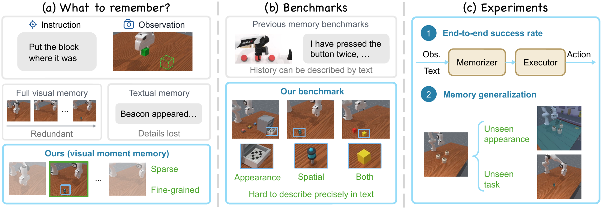
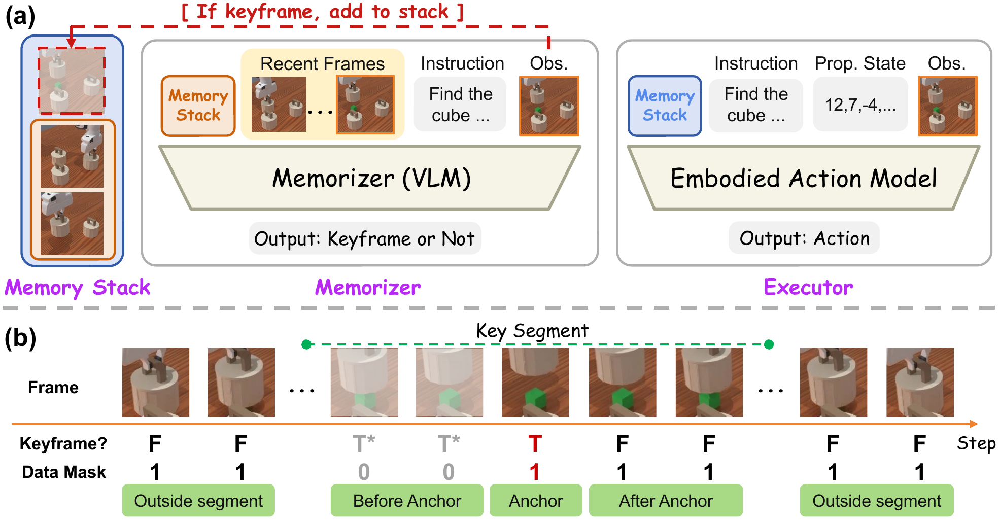

<h1 align="center">MomentMem: Memorizing Key Moments for Robot Manipulation</h1>

<p align="center">
  <a href="https://arxiv.org/abs/2611.26745"></a>
  <a href="https://pku-value-lab.github.io/MomentMem"></a>
</p>

**Visual moment memory for robotic manipulation.** A VLM memorizer saves transient visual evidence as keyframes. A VLA executor uses these memories to act. VMBench contains nine tasks that require this capability.



Robots often need visual details that are no longer visible, such as where an object was placed. MomentMem keeps sparse keyframes from key moments instead of the full image history or a text summary.



The memorizer decides at each step whether to store the current frame. The executor predicts actions from the stored keyframes and the current observation.

## Checkpoints

| Setting | Memorizer | Executor |
| --- | --- | --- |
| VMBench | [MomentMem-VLM](https://huggingface.co/frenzyfreeze/open-MomentMem-VLM) | [MomentMem-VLA-ID](https://huggingface.co/frenzyfreeze/open-MomentMem-VLA-ID) |
| VMBench visual OOD | Same memorizer | [MomentMem-VLA-OOD-scratch](https://huggingface.co/frenzyfreeze/open-MomentMem-VLA-OOD-scratch) |


## Setup

Use Linux, Python 3.11, NVIDIA GPUs, FFmpeg, and [uv](https://docs.astral.sh/uv/). Run from this directory. Separate environments avoid dependency conflicts.

```bash
for env in memorizer serving benchmark; do
  uv venv --python 3.11 ".venv-$env"
  uv pip install --python ".venv-$env/bin/python" -r "requirements/$env.txt"
done
uv sync --project executor
```

## Training

Replace the quoted placeholders with local paths:

```bash
DATA_PATH='{data_path}' OUTPUT_PATH='{output_path}' \
MEMORIZER_BASE_PATH='{memorizer_base_path}' EXECUTOR_BASE_PATH='{executor_base_path}' \
bash scripts/train.sh
```

`{data_path}` contains `lerobot_format/<task>/{data,meta,videos}`. `{memorizer_base_path}` is a local Qwen3-VL-4B-Instruct model directory. `{executor_base_path}` is the π₀.₅ base checkpoint's `params/` directory. `{output_path}` is a writable directory for models and intermediate outputs.

The script trains the memorizer for 10,000 steps, generates its memory predictions, and trains the executor for 60,000 steps. It uses eight GPUs and the VMBench settings in [configs/memorizer.json](configs/memorizer.json). Inference exports are saved under `{output_path}/release/{memorizer,executor}`. Raw checkpoints remain local for resuming training; publish only the inference exports. To export an existing checkpoint, use `python scripts/export_checkpoint.py {vlm|vla} --source '{checkpoint_path}' --output '{export_path}'`.

## Inference and evaluation

Set these variables in each terminal. Assign separate GPUs to the model services with `CUDA_VISIBLE_DEVICES`.

```bash
export MEMORIZER_PATH='{memorizer_path}' EXECUTOR_PATH='{executor_path}'
export RESULT_PATH='{result_path}'
bash scripts/eval.sh memorizer  # Terminal 1
bash scripts/eval.sh executor   # Terminal 2
bash scripts/eval.sh evaluate   # Terminal 3, once both services are ready
```

`{memorizer_path}` contains the VLM weights and `keyframe_prompt_config.json`. `{executor_path}` contains `params/` and `assets/`. `{result_path}` is a new writable directory for evaluation results. The example evaluates 100 episodes per task with ray tracing, a 2,000-step limit, and 10-action chunks.

When calling Python entry points directly, replace the path placeholders in the configuration or override them. `MOMENTMEM_ASSETS_PATH` sets the normalization output directory; `MOMENTMEM_CHECKPOINT_PATH` sets the executor checkpoint output directory. The training script sets both automatically.

## Citation

```bibtex
@article{momentmem,
  title={MomentMem: Memorizing Key Moments for Robot Manipulation},
  author={Zhao, Guangyu and Zhang, Yongchang and Jiang, Ruizhang and Yu, Zhihong and Zhang, Yuhao and Wu, Tao and Zhou, Qimin and Shi, Kunsong and Wen, Haoran and Zhang, Zeyu and Li, Yin and Zhan, Kun and Zhong, Yiwu},
  journal={arXiv preprint arXiv:2611.26745},
  year={2026}
}
```

## License

MomentMem uses the [MIT License](LICENSE). Code in `executor/` is modified from [OpenPI](https://github.com/Physical-Intelligence/openpi) and retains its [Apache-2.0 license](executor/LICENSE). We build on OpenPI, Qwen3-VL, ManiSkill, and LeRobot.
